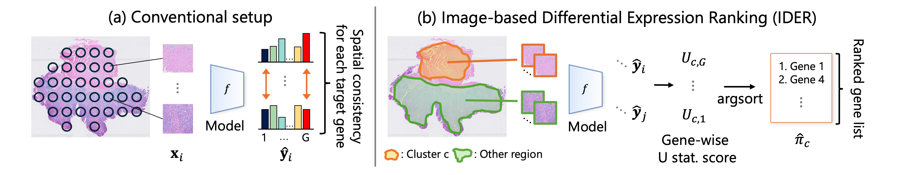

# IDER: Preserving DEG Rankings for Gene Discovery in Histology-Based Spatial Gene Expression Prediction

**Accepted at NeurIPS 2026**

[**Project Page**](https://shiku-kaito.github.io/IDER-project-page/) | [**Paper (arXiv)**](https://arxiv.org/abs/2609.33928) | [**Code**](https://github.com/Shiku-Kaito/IDER) | [**Metric Tutorial**](tutorial/01_tutorial_metrics.ipynb) | [**Loss Tutorial**](tutorial/02_tutorial_losses.ipynb) | [**Citation**](#citation)



This is the official implementation of **IDER (Image-based Differential Expression Ranking)**, introduced in *Preserving DEG Rankings for Gene Discovery in Histology-Based Spatial Gene Expression Prediction* (NeurIPS 2026).

Most histology-based spatial transcriptomics (ST) prediction methods focus on reconstructing gene expression profiles. However, a key downstream goal of ST analysis is **differentially expressed gene (DEG) discovery**, where the relative ranking of genes for a tissue-region contrast matters. IDER directly targets the preservation of DEG rankings using a differentiable ranking objective based on the Mann–Whitney U-statistic, combined with a Pearson correlation coefficient (PCC) loss. Morphology-derived clusters provide proxy contrasts during training, without requiring predefined biological group labels.

## What does this repository provide?

- **IDER training and evaluation:** An ST-Net regressor on [CONCH](https://github.com/mahmoodlab/CONCH) histology patch features, trained with the DEG-rank and PCC losses.
- **Baseline implementations:** ST-Net trained with MSE or PCC alone.
- **DEG-ranking evaluation:** DEG Spearman correlation and nDCG@50/100/200 (binary relevance) for evaluating agreement between predicted and measured differential-expression rankings.
- **Standalone tutorials:** Jupyter notebooks demonstrating the **evaluation metrics and loss functions on toy data**, without downloading HER2ST, accessing CONCH weights, or using a GPU.

> **Only interested in the metrics or losses?** Start with the [metric tutorial](tutorial/01_tutorial_metrics.ipynb) or [loss tutorial](tutorial/02_tutorial_losses.ipynb). You do **not** need to run the full training pipeline.

The training and evaluation pipeline provided here focuses on the [HER2ST dataset](https://zenodo.org/records/3957257), using four-fold patient-rotation cross-validation.

## Tutorials: Using IDER metrics and losses

The [`tutorial/`](tutorial/) directory contains two self-contained notebooks with toy examples:

| Tutorial | What you can learn and reuse |
| --- | --- |
| [**01 – DEG-ranking metrics**](tutorial/01_tutorial_metrics.ipynb) | `DEG_ranking` for Mann–Whitney U-scores and `DEG_metric_func` for DEG Spearman correlation and nDCG@k. |
| [**02 – Differentiable losses**](tutorial/02_tutorial_losses.ipynb) | `Diff_Uscore`, `DEGrank_loss`, PCC loss, and the combined IDER objective. |

**No HER2ST download, CONCH model weights, or GPU is required to run these toy-data examples.** Install the Python dependencies and open the notebooks in VS Code with the Jupyter extension or in JupyterLab, using the `IDER` environment as the kernel.

The underlying implementations can also be found in [`script/culc_DEG_metrics.py`](script/culc_DEG_metrics.py) and [`script/losses.py`](script/losses.py).

## Repository structure

```text
IDER/
├── figures/               # Concept figure and other visual assets
├── preprocessing/         # HER2ST download, preprocessing, CONCH features, CV splits
├── script/                # IDER / baseline training and evaluation
│   ├── IDER_script/       # IDER training loop
│   ├── baseline_script/   # Baseline training loop
│   ├── main.py            # Training / evaluation entry point
│   ├── losses.py          # Differentiable DEG-rank and reconstruction losses
│   └── culc_DEG_metrics.py # DEG-ranking evaluation metrics
├── tutorial/              # Standalone notebooks for metrics and losses
├── requirements.txt
└── LICENSE
```

The pipeline generates `data/` (approximately 16 GB) and `result/` locally; these are not included in the repository. Paths are resolved through `script/paths.py`, independent of the current working directory. You can customize the output locations with `IDER_DATA_ROOT` and `IDER_RESULT_ROOT`.

## Installation

Clone the repository and create the environment:

```bash
git clone https://github.com/Shiku-Kaito/IDER.git
cd IDER

conda create -n IDER python=3.9 -y
conda activate IDER
pip install -r requirements.txt
```

For the **full HER2ST pipeline**, also install the official CONCH package:

```bash
pip install git+https://github.com/mahmoodlab/CONCH.git
```

A CUDA GPU is needed for CONCH feature extraction and recommended for model training. The standalone tutorials do not require a GPU.

## Reproducing the HER2ST experiments

### 1. Prepare the data

You will need:

| Resource | How to obtain it |
| --- | --- |
| HER2ST dataset and ZIP passwords | Download from [Zenodo](https://zenodo.org/records/3957257). The two ZIP passwords are provided in the [original HER2ST repository](https://github.com/almaan/her2st). |
| CONCH model weights | Request access at [MahmoodLab/CONCH](https://huggingface.co/MahmoodLab/CONCH) and generate a token in [Hugging Face settings](https://huggingface.co/settings/tokens). |

HER2ST uses one password for `count-matrices.zip` / `images.zip` and a second password for `meta.zip` / `spot-selections.zip`.

Set the following environment variables, then run the preprocessing pipeline:

```bash
export HER2ST_ZIP_PASSWORD_COUNTS_IMAGES="<password_1>"
export HER2ST_ZIP_PASSWORD_META_SPOTS="<password_2>"
export HF_TOKEN="<hugging_face_token>"

bash preprocessing/run_preprocessing.sh
```


The preprocessing steps are:

| Step | Script | Output |
| --- | --- | --- |
| 0 | `00_download_Her2st_and_CONCH.py` | Verified downloads, extracted HER2ST files, and CONCH checkpoints. |
| 1 | `01_align_directory.py` | Per-slide images, expression data, selections, and annotations. |
| 2 | `02_crop_patches.py` | HDF5 files containing patches, expression, and pathologist labels. |
| 3 | `03_extract_features.py` | CONCH features added to the HDF5 files. |
| 4 | `04_common_genes.py` | HDF5 files restricted to genes shared across slides. |
| 5 | `05_split_cv.py` | Four patient-level folds in `cross_validation/cv_splits.json`. |

Generated HER2ST files are stored under `data/Her2st/`, while CONCH checkpoints are stored under `preprocessing/checkpoints/conch/`. Steps can also be run separately from the repository root (for example, `python preprocessing/01_align_directory.py`). Already downloaded files are skipped.

> Note: The filename suffix `_preprcessed.h5` contains a spelling error in the existing code; it is preserved for compatibility.

### 2. Train and evaluate IDER

Run the commands from `script/`:

```bash
cd script

# IDER: DEG-rank loss + PCC loss
python main.py --module IDER --batch_size 1024 --loss pcc --is_evaluation 0
python main.py --module IDER --batch_size 1024 --loss pcc --is_evaluation 1

# Baseline: MSE loss
python main.py --module baseline --batch_size 1024 --loss mse --is_evaluation 0
python main.py --module baseline --batch_size 1024 --loss mse --is_evaluation 1

# Baseline: PCC loss
python main.py --module baseline --batch_size 1024 --loss pcc --is_evaluation 0
python main.py --module baseline --batch_size 1024 --loss pcc --is_evaluation 1
```

Alternatively, `bash run.sh` runs IDER, baseline-MSE, and baseline-PCC. By default, training processes four folds sequentially, for 1,000 epochs each.

**Main arguments** (see [`script/main.py`](script/main.py)):

| Argument | Default | Description |
| --- | --- | --- |
| `--module` | `IDER` | `IDER` or `baseline`. |
| `--loss` | `pcc` | PCC component for IDER; `mse` or `pcc` for baselines. |
| `--PCCLoss_lambda` | `1.0` | Weight of PCC loss: `L_IDER = L_DEG + lambda * L_PCC`. |
| `--temperature` | `0.01` | Temperature for the differentiable U-score. |
| `--folds` | `0 1 2 3` | CV folds to run, e.g. `--folds 0`. |
| `--ndcg_topk` | `50 100 200` | nDCG cutoffs; the largest cutoff is used for model selection. |
| `--clustering_k` | `10` | Number of morphology-derived k-means clusters during training. |
| `--num_epochs` | `1000` | Number of training epochs. |
| `--lr` | `3e-4` | Learning rate. |
| `--batch_size` | `1024` | Batch size. |
| `--seed` | `0` | Random seed. |

The best checkpoint is chosen by the validation nDCG at the largest specified cutoff and stored as `best_model_cluster.pkl`. The evaluation step loads that checkpoint. Use matching `--ndcg_topk` values for training and evaluation.

### 3. Results

Results are saved under the directory specified by `IDER_RESULT_ROOT` (or the default `result/`):

```text
result/Her2st/eval_top_genes=<G>_TrainCluster_k=10/w_pretrain_lr=3e-4/<mode>_loss=<loss>/
├── model/                  # Best checkpoints (per fold)
├── log_dict/               # Training logs
├── loss_graph/              # Loss curves
├── acc_graph/               # Validation metric curves
└── test_metrics/
    └── result.txt          # Four-fold mean ± std of DEG Spearman and nDCG@k
```

`<mode>` is `IDER_PCCLoss_lambda=1.00` for IDER or `ST_net_DEGrank_stop` for the baselines.

## Implementation details

| File | Purpose |
| --- | --- |
| [`script/main.py`](script/main.py) | Argument parsing and training/evaluation entry point. |
| [`script/get_module.py`](script/get_module.py) | Model, optimizer, loss, and dataloader construction. |
| [`script/IDER_script/train.py`](script/IDER_script/train.py) | IDER training loop. |
| [`script/baseline_script/train.py`](script/baseline_script/train.py) | Baseline training loop. |
| [`script/losses.py`](script/losses.py) | `PearsonCorrCoef_loss`, `MSE_loss`, `Diff_Uscore`, `DEGrank_loss`. |
| [`script/culc_DEG_metrics.py`](script/culc_DEG_metrics.py) | `DEG_ranking` and `DEG_metric_func`. |
| [`script/eval.py`](script/eval.py) | Validation and test evaluation. |
| [`script/dataloader.py`](script/dataloader.py), [`script/model.py`](script/model.py), [`script/utils.py`](script/utils.py) | Data loading, ST-Net, and utilities. |

During IDER training, two clusters are sampled per batch, and the DEG-rank loss uses the last sampled cluster. Test metrics compare differential-expression rankings computed from predicted and measured expression profiles using pathologist-annotated tissue regions.

## Citation

If you use IDER or its metrics and loss functions in your research, please cite our paper:

```bibtex
@misc{shiku2026preserving,
  title         = {Preserving DEG Rankings for Gene Discovery in Histology-Based Spatial Gene Expression Prediction},
  author        = {Shiku, Kaito and Nishimura, Kazuya and Kojima, Yasuhiro and Bise, Ryoma},
  year          = {2026},
  eprint        = {2609.33928},
  archivePrefix = {arXiv},
  primaryClass  = {cs.CV},
  note          = {Accepted to NeurIPS 2026}
}
```

## License and acknowledgements

This repository is released under the [MIT License](LICENSE). The HER2ST dataset and CONCH model weights are **not** covered by this repository's license; follow their respective licenses and access conditions.

We thank the authors of [HER2ST](https://github.com/almaan/her2st) and [CONCH](https://github.com/mahmoodlab/CONCH) for making their resources available.
